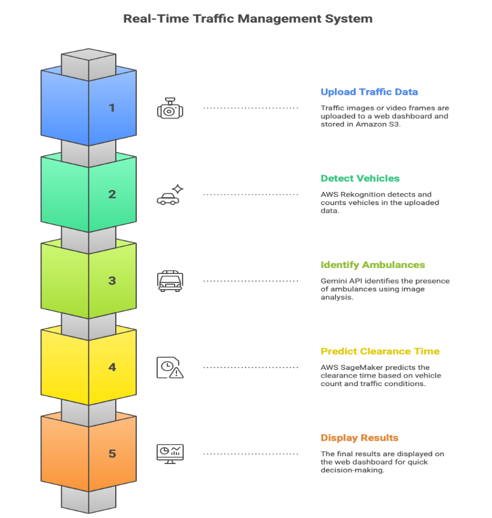
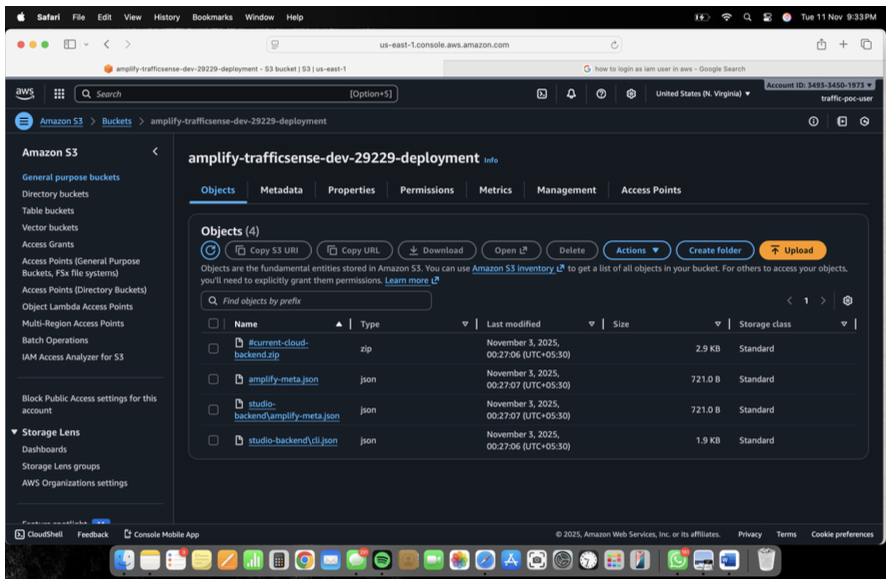
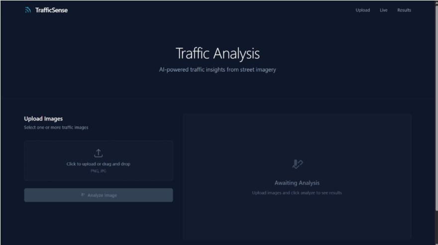
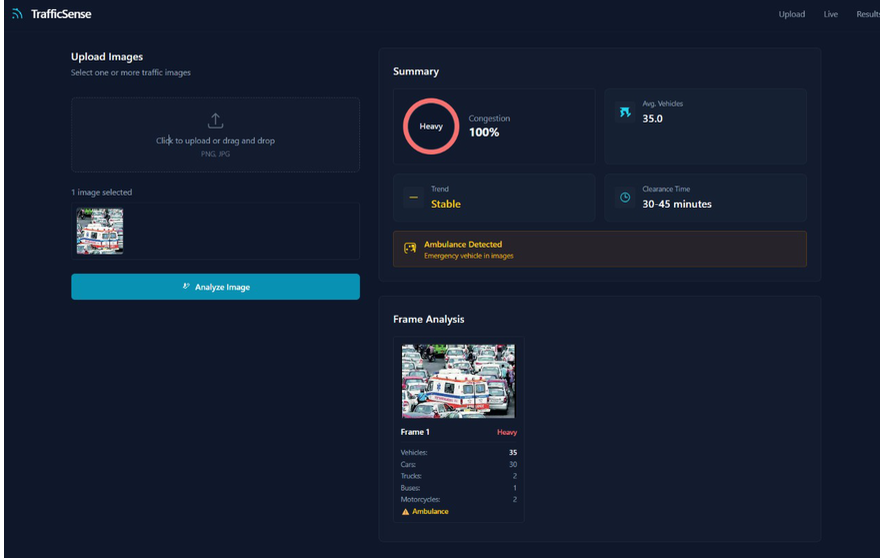

# TrafficSense — Intelligent Traffic Management

A cloud-based traffic analysis system designed to combine vehicle detection, ambulance identification, and traffic clearance-time prediction in a single web dashboard.

## Overview

TrafficSense explores how cloud computing and AI can support intelligent traffic monitoring. Users upload traffic images or video frames through a web interface, and the system presents analysis results to support traffic awareness and emergency-response coordination.

## Key Features

- **Vehicle Detection and Counting:** Uses AWS Rekognition to identify and count vehicles.
- **Ambulance Identification:** Uses the Gemini API to analyze traffic images for ambulance presence.
- **Traffic Clearance-Time Prediction:** Uses AWS SageMaker for regression-based prediction.
- **Cloud Storage:** Uses Amazon S3 to store uploaded media.
- **Web Dashboard:** Presents traffic analysis results, including vehicle counts, congestion information, ambulance alerts, and estimated clearance time.

## System Workflow

1. Upload traffic images or video frames through the dashboard.
2. Store uploaded media in Amazon S3.
3. Analyze vehicle types and counts using AWS Rekognition.
4. Analyze ambulance presence using the Gemini API.
5. Predict traffic clearance time using AWS SageMaker.
6. Display the analysis results on the dashboard.

## Technologies Used

- Python and web application development
- Amazon Web Services (AWS)
- AWS Rekognition
- AWS SageMaker
- Amazon S3
- Gemini API
- Machine learning and regression
- Cloud-based data processing

## Project Gallery

### 1. Proposed Methodology

### 2. Amazon S3 Storage

### 3. TrafficSense Dashboard

### 4. Vehicle Detection and Ambulance Alert

## Repository Structure

- `docs/` — Project report
- `images/` — Methodology diagram, cloud storage screenshot, and dashboard screenshots
- `README.md` — Project overview and documentation

## Team Members

- Sanjay C
- Abishek Guru M
- Meenakshi Sundaram M
- Damini Katakam

## Limitations and Future Work

Potential future improvements described in the project report include live video streaming, adaptive traffic-signal control using reinforcement learning, pedestrian detection, detection of additional emergency vehicles, and hybrid edge–cloud processing.

## Disclaimer

This project is an academic prototype. Its outputs should be validated before use in real traffic-control or emergency-response decisions.
